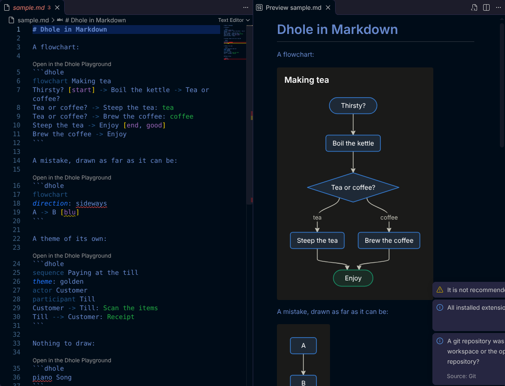

# Dhole in Markdown

Draws **Dhole** diagrams in VS Code's Markdown preview, the way Mermaid diagrams are drawn there, and the way Divooka draws them.



[Dhole](https://wiki.methodox.io/Libraries/Dhole/) is Methodox's small language for charts and diagrams written as text. You name what to draw on the first line and say what it shows on the lines after; Dhole lays it out and draws it. Write one in a fenced code block whose language is `dhole`:

````markdown
```dhole
flowchart Making tea
Thirsty? [start] -> Boil the kettle -> Tea or coffee?
Tea or coffee? -> Steep the tea: tea
Tea or coffee? -> Brew the coffee: coffee
Steep the tea -> Enjoy [end, good]
Brew the coffee -> Enjoy
```
````

Open the preview (**Ctrl+Shift+V**, or **Ctrl+K V** to the side) and the block is a picture.

## What it does

- **Draws ```` ```dhole ```` blocks in the Markdown preview.** Flowcharts, sequence, state, class and entity diagrams, mind maps, timelines, Gantt charts, pie, bar, line, scatter, radar and quadrant charts, and boards.
  - The drawing is Dhole's own public build ([MethodoxTech/MethodoxDhole](https://github.com/MethodoxTech/MethodoxDhole)), a port of Divooka's Dhole that is held to it text by text, so a diagram looks here as it does in Divooka.
  - Text is measured in the preview's own fonts, so every box fits its words.
- **Says what is wrong, and where.** Dhole draws as much of a text as it can read, and says the rest in the Problems panel and with a squiggle under the text: its line and column in the document, what is wrong, and what to write instead. The same problems are listed under the picture in the preview.
- **Follows your editor's theme.** A light editor theme gets a light diagram, a dark one a dark diagram, and a high-contrast one Divooka's high-contrast palette. A diagram that names a theme (`theme: golden`) keeps it.
- **Colours Dhole.** The text is coloured in ```` ```dhole ```` blocks and in `.dhole` files: kinds, settings, arrows, labels, attributes, names in quotation marks, numbers, dates and comments.
- **`.dhole` files.**
  - They are their own language, with `#` comments, brackets and indentation.
  - **Dhole: Open Preview** (the preview button in the editor's title bar) draws one beside it, redrawn as you type.
- **The playground.** *Open in the Dhole Playground* above each block opens its text in the [Dhole playground](https://wiki.methodox.io/Libraries/Dhole/Playground/) on the Methodox Wiki, to share it or to try changes.

## Settings

| Setting | Default | |
|-|-|-|
| `dhole.preview.theme` | `auto` | The theme a diagram is drawn in when its text names none. `auto` follows the editor; or one of `light`, `dark`, `presentation`, `minimal`, `classic`, `print`, `golden`, `quiet gold`, `silver gold`, `high contrast`. |
| `dhole.preview.showProblems` | `true` | List each diagram's problems under its picture. |
| `dhole.preview.language` | `English` | The language problems are said in: `English` or `Chinese`. |
| `dhole.diagnostics.enabled` | `true` | Report problems in the Problems panel. |
| `dhole.codeLens.enabled` | `true` | Show *Open in the Dhole Playground* above each block. |

## Learning Dhole

- [The Dhole pages on the Methodox Wiki](https://wiki.methodox.io/Libraries/Dhole/): a page for each kind of diagram, the language, and what each problem means.
- [The playground](https://wiki.methodox.io/Libraries/Dhole/Playground/): an example of every kind, to start from.
- [The specification](https://github.com/MethodoxTech/MethodoxDhole/blob/main/spec/Dhole%20Language.md).

Fifteen of Dhole's seventeen kinds are drawn on the web so far. A Sankey diagram or a table is said, drawn in Divooka only for now, and left out, while the other diagrams of the text are drawn.

## Working on it

```
npm install
npm run build          # dist/extension.js, what VS Code loads
npm test               # the fences, the markdown-it plugin, the problems' places, the grammar, and the built extension against a stand-in for VS Code
npm run test:preview   # the preview's script in Chromium (npx playwright install chromium once)
npm run test:vscode    # the whole extension inside a real VS Code (downloaded once into .vscode-test/; on Linux without a display, under xvfb-run)
npm run package        # the .vsix
npm run update-dhole   # take the newest Dhole 0.2 release into media/ and vendor/ (or name a version: -- 0.3.0)
```

How it fits together:
- **In VS Code's extension host,** `src/extension.ts` hands the Markdown preview a markdown-it plugin (`src/markdownIt.ts`). The plugin writes each ```` ```dhole ```` block as an element holding its text.
- **In the preview,** `media/preview.js` draws each block with `media/dhole.min.js`.
- **Problems** are read with the same build's module, `vendor/dhole.esm.js`, bundled into `dist/extension.js`.

Press **F5** in this folder to run it in a new VS Code window.

## Licence

MIT, as Dhole's public build and specification are. Copyright © 2024-2026 Methodox Technologies, Inc.
